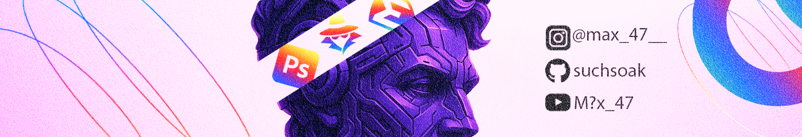

<!-- Animated Wave Header -->

  

<!-- Animated Typing Headline -->

  

<!-- Hero Banner & Animated Side Visuals -->

  

 

<table align="center" border="0" cellspacing="0" cellpadding="0">
  <tr>
    <td width="22%" align="center">
      <!-- Gif credit: supuna97 -->
      
    </td>
    <td width="56%" align="center">
      <h3>⚡ Connect & Explore My Work</h3>
      
Developer · Designer · Creative Technologist

      

        
      

    </td>
    <td width="22%" align="center">
      
    </td>
  </tr>
</table>

<!-- Social & Portfolio Links (Unified for-the-badge style) -->

  
  
  
  
  
  
  

   
  

## 🧬 About Me

> Hello! I'm Maxsuell — passionate about programming, visual design, 3D art, and building creative projects across the full technology stack. Thanks for stopping by my profile!

  
<b>✨ Click to expand quick highlights about me</b>

   

  | Area | Focus & Craft |
  | :--- | :--- |
  | 💻 **Development** | C, Python, Ruby, JavaScript, HTML5, Bash & PowerShell Automation |
  | 🎨 **Design & 3D** | UI/UX in Figma, Graphic Art in Photoshop/Illustrator/Krita & 3D Modeling in Blender |
  | ☁️ **Cloud & Deploy** | Google Cloud Platform, Oracle Cloud & Netlify |
  | 🎯 **Mindset** | Bridging low-level code, scripting, cloud infra, and visual storytelling |

## 📊 GitHub Analytics

  <table>
    <tr>
      <td align="center">
        
      </td>
      <td align="center">
        
      </td>
    </tr>
  </table>

  <table>
    <tr>
      <td align="center">
        
      </td>
      <td align="center">
        
      </td>
    </tr>
  </table>
   
  

## 💻 Tech Stack & Creative Arsenal

  <table>
    <tr>
      <th align="center">⚙️ Languages &amp; Scripting</th>
    </tr>
    <tr>
      <td align="center">
        
        
        
        
        
        
        
      </td>
    </tr>
    <tr>
      <th align="center">🎨 Design, Illustration &amp; 3D</th>
    </tr>
    <tr>
      <td align="center">
        
        
        
        
        
        
        
        
        
      </td>
    </tr>
    <tr>
      <th align="center">☁️ Cloud, Terminal &amp; Hosting</th>
    </tr>
    <tr>
      <td align="center">
        
        
        
        
      </td>
    </tr>
  </table>

## 🐍 Contribution Snake

  <picture>
    <source media="(prefers-color-scheme: dark)" srcset="https://raw.githubusercontent.com/suchsoak/suchsoak/output/github-contribution-grid-snake-dark.svg" />
    <source media="(prefers-color-scheme: light)" srcset="https://raw.githubusercontent.com/suchsoak/suchsoak/output/github-contribution-grid-snake.svg" />
    
  </picture>

<!-- Animated Wave Footer -->

  

